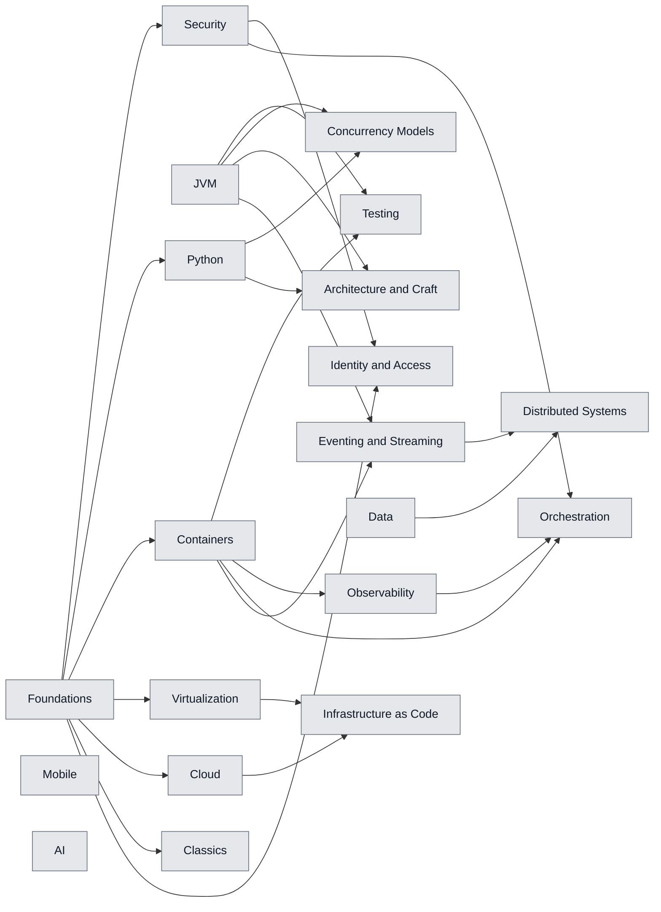
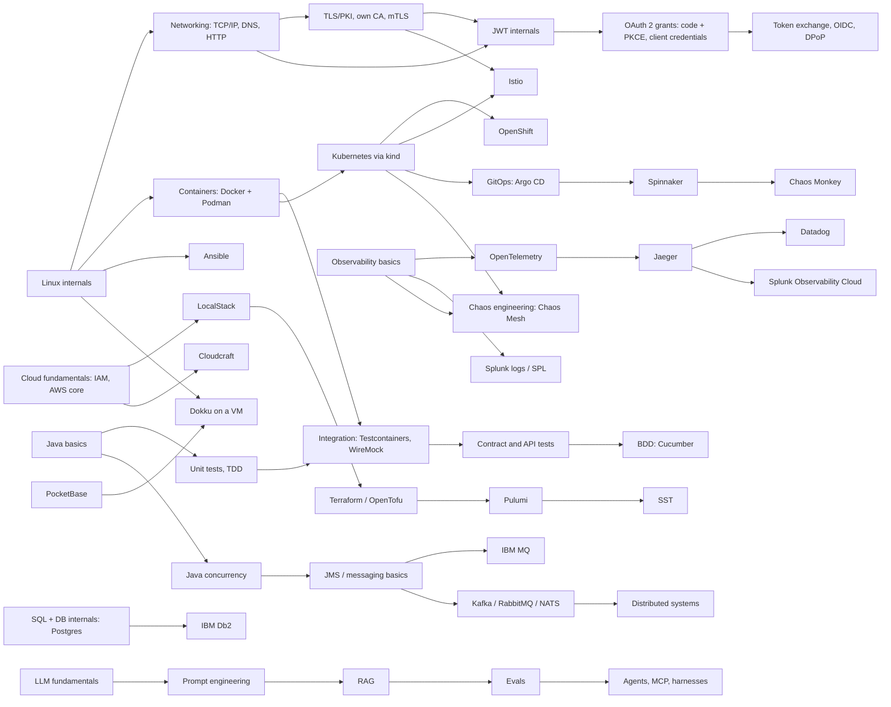

# learning-lab

An umbrella repo for learning things properly, one isolated lab at a time: TLS and PKI, JWT and
OAuth, Java concurrency and testing, Python web frameworks, Flutter, containers and
virtualization, Kubernetes and OpenShift, cloud, IaC, observability, eventing, databases,
distributed systems, AI agents and more. It also holds **skill-assessment prep**: you paste a
competency matrix (for example prompt engineering, Novice → Advanced), and a tutor prepares you
for one level.

> **Template:** made from
> [learning-lab-template](https://github.com/LasterBergamot/learning-lab-template)
> (`.github/template-source`). To start your own, click **Use this template** there. To get
> template changes, run `scripts/template-sync.sh` and merge with a merge commit.
> Details: [Template](docs/Template.md).

This README is the router: it says what this is and how it works, what you need installed,
how to learn here ([Learning, step by step](#learning-step-by-step): open Claude Code at the
repo root and run `/learn`), where you stand (the progress graph), and links to every track and
page.

## How it works

- **One lab per folder.** Every topic gets its own folder under `labs/<track>/<lab>/`, its own
  containers or toolchain, and its own teardown. You can start, stop or delete one lab without
  touching any other ([Isolation](docs/Isolation.md)).
- **AI as a Socratic tutor, not a code generator.** The AI asks questions, gives hints one rung
  at a time, plans labs, checks prerequisites and keeps the docs current. **It never writes lab
  code.** Every line of code, config and infrastructure in `labs/` is yours
  ([How I Learn](docs/How-I-Learn.md)).
- **Claude Code.** The rules live in [`CLAUDE.md`](CLAUDE.md), with a tutor output style and
  deny rules in `.claude/`. Prompt suggestions are turned off there too, because a suggested
  next prompt can give away the next step. The skills come from ai-common through
  [APM](https://github.com/microsoft/apm).
- **Progress lives in the repo.** Each lab README has a `**Status:**` line; the graphs below and
  in each track README follow it ([Progress](#progress)).
- **Linux with Docker.** Everything runs on Omarchy in a VM (Try Omarchy for Windows) and on
  any other Arch-based or other Linux distro ([Platforms](docs/Platforms.md)).

### What the AI writes, and what you write

| AI writes | Only you write |
|---|---|
| Markdown: lab briefs, notes, docs, glossary, Mermaid graphs, session logs | Application code in any language |
| Skills, agents, `CLAUDE.md`, the output style (these are prompts) | Dockerfiles/Containerfiles, compose files, Kubernetes manifests, Terraform/Pulumi, Ansible |
| Repo tooling: `scripts/`, CI, `.gitignore`, issue forms, `apm.yml` | Scripts, configs, keys and certificates inside labs |
| GitHub issues and the board (optional, drafts you approve) | Anything under `labs/` that is not Markdown |

## Prerequisites

Check what is missing with one command:

```bash
bash scripts/prereqs.sh --check                  # what is installed, what is missing
bash scripts/prereqs.sh --check --track identity # plus the tools one track needs
bash scripts/prereqs.sh --install                # installs what is missing, asking per tool
```

- **Linux:** bash, Docker with compose, mise, uv; system packages from pacman on Omarchy and
  other Arch-based distros, or from your own package manager elsewhere.
- Also: git, gh, jq, shellcheck (lints `scripts/*.sh`) and the APM CLI. Optional: the machine setup
  from [dev-config](https://github.com/LasterBergamot/dev-config) (status line, deny rules, git
  aliases) and ai-common's guard hooks ([Setup](docs/Setup.md) steps 9 and 10).

The full runbook, step by step with the expected result of each step, is [Setup](docs/Setup.md).

## Learning, step by step

You need one command and one skill. Start Claude Code **at the repo root** (not inside a lab
folder) and run `/learn`:

```bash
cd learning-lab
claude
> /learn
```

**1. It shows where you stand.** `/learn` runs `python3 scripts/lab-status.py` (you can run it
yourself too) and gives you a short overview:

```text
In progress
  ai/rag  building  (labs/ai/rag) · last session 2026-11-25: steps 1–3 of the walkthrough
    stopped: store_faiss.py has a TODO for step 4, retrieval. main.py is still empty.
    next:    step 4, retrieval. Then wire the steps together into one entry point.
Review queue: 2 due of 9
Ready to start: foundations: linux-processes, networking-tcpip, … · ai: ml-math
```

**2. You say what you want.** Pick from the overview, or just say it in your own words. You can
also say it straight away: `/learn continue rag`.

| You say | What happens |
|---|---|
| "continue rag" | It reads the lab's last notes entry, moves into `labs/ai/rag/`, and `socratic-tutor` starts from the **Next step** |
| "what should I learn next?" | It asks up to three questions about what you want to learn (what, how deep, how much time), checks your progress, the graphs and the web, and recommends up to five labs, each with a reason and its cost |
| "I want to learn Kafka" | It finds the lab in the graphs, or plans a new one: `plan-lab` runs `prereq-check`, writes the brief with you and adds it to the track graph. Then the tutoring starts |
| "do my reviews" | `review-quiz` asks the recall questions that are due |
| "prepare the prompt-engineering assessment" | `assessment-prep` (or `import-matrix` first, if there is no matrix yet) |

**3. You learn.** The tutor asks questions, you write every line of code yourself in the lab
folder, in your own terminal. When you're stuck, it gives hints one rung at a time
([How I Learn](docs/How-I-Learn.md)).

**4. You stop.** Say you're done. `session-log` writes the session into the lab's `NOTES.md`
in your words, ending with **Where I stopped** and **Next step**. It also adds recall questions
to the review queue, records the sources, proposes the Status change, and proposes a checkpoint
commit and push. It asks before every git command. Next time, on any machine, `/learn` picks up
from that entry.

Nothing about you is stored apart from your learning record: notes, Status lines, the review
queue, assessment readiness and the lab briefs you chose. The answers you give when it asks
what to learn are only used in that session. The skills below still work on their own if you
want to call one directly: `plan-lab <track>/<lab>`, `socratic-tutor`, `prereq-check`,
`session-log`, `review-quiz`, `roadmap-sync` (updates the graphs and the readiness heatmap),
`import-matrix <subject>` and `assessment-prep <subject> <level>`.

## Progress

Tracks and what comes before what. An arrow means "learn this first". A track turns
yellow or blue when any of its labs has started, and green when all of them are done. Each
track README has the same kind of graph for its labs.

<!-- roadmap-sync:start -->

<!-- roadmap-sync:end -->

The region between the `roadmap-sync` markers is rewritten by the `roadmap-sync` skill from
the labs' `**Status:**` lines. Don't edit the `class` lines by hand.

Each box's id is what ties it to its lab, so order doesn't matter. In this graph a box is
named after its track (`foundations`). In a track's graph a box is named after its lab, with
`-` written as `_`: the `ml-math` row in the lab table belongs to the `ml_math` box. If you
change a track's plan by hand, add or rename the box and its table row together. CI
(`scripts/check_docs.py`) fails on a box without a row or a row without a box. `plan-lab`
follows the same rule.

### Legend

| Colour | Status | Meaning |
|---|---|---|
| Grey | `todo` | Not started |
| Yellow | `learning` | Understand milestone in progress |
| Blue | `building` | Build, break or fix in progress |
| Green | `done` | All five milestones ticked, including explain-it-back |

A track node is `done` when all its labs are done, `learning` or `building` when any lab has
started, and `todo` otherwise.

### Suggested order

Foundations → Security (TLS) → Identity → Containers → JVM concurrency → Testing → Python web →
Eventing → Distributed systems → Cloud and Kubernetes → AI. Mobile and the classics fit in
between whenever you like. The arrows are the real constraint; the order is only a suggestion.
Before you start any track or lab, the AI runs `prereq-check`, which checks this graph and
online sources for anything you should learn first.

<details>
<summary>The tool-level map (which tool comes before which)</summary>



[Tool Landscape](docs/Tool-Landscape.md) explains which of these tools overlap and which to
learn first.

</details>

## Tracks

GitHub's Mermaid renderer disables clickable nodes, so every track README is linked here.

| Track | Why it lasts | Starts after |
|---|---|---|
| [Foundations](labs/foundations/README.md) | Linux, networking and HTTP: every other track is built on them | — |
| [Security](labs/security/README.md) | TLS/PKI, secrets, supply chain, threat modelling, post-quantum TLS | Foundations |
| [Identity and Access](labs/identity/README.md) | JWT, OAuth 2 grants, client credentials, token exchange, OIDC, passkeys | Foundations, Security (TLS) |
| [JVM](labs/jvm/README.md) | The Java memory model, concurrency, virtual threads, JFR, JMH | — |
| [Testing](labs/testing/README.md) | The test pyramid in Java, level by level, with TDD and BDD | JVM, Containers (for Testcontainers) |
| [Python](labs/python/README.md) | Flask, FastAPI and Django: three web-framework philosophies | Foundations (HTTP) |
| [Concurrency Models](labs/concurrency/README.md) | Threads, async/await, actors and CSP: one problem four ways | JVM or Python |
| [Mobile](labs/mobile/README.md) | Flutter's declarative UI model across mobile, desktop and web | — |
| [Containers](labs/containers/README.md) | Containers from scratch, OCI images, Docker and Podman | Foundations |
| [Virtualization](labs/virtualization/README.md) | Hypervisors, KVM/QEMU, Vagrant, microVMs | Foundations |
| [Orchestration](labs/orchestration/README.md) | Kubernetes, OpenShift, Istio, GitOps, chaos engineering | Containers, Security, Observability |
| [Observability](labs/observability/README.md) | Logs, metrics and traces with OpenTelemetry, Jaeger, Datadog, Splunk | Containers |
| [Infrastructure as Code](labs/iac/README.md) | Terraform/OpenTofu, Pulumi, SST and Ansible | Cloud, Virtualization |
| [Cloud](labs/cloud/README.md) | AWS, GCP and Azure building blocks, emulators first | Foundations |
| [Eventing and Streaming](labs/eventing/README.md) | Queues vs. logs: IBM MQ, Kafka, RabbitMQ, NATS, CDC | Containers, JVM |
| [Data](labs/data/README.md) | Storage engines, indexes, isolation levels; Postgres, Db2, PocketBase | — |
| [Distributed Systems](labs/distributed/README.md) | Partial failure, consistency, clocks and consensus | Eventing, Data |
| [Architecture and Craft](labs/architecture/README.md) | API design, DDD, hexagonal architecture, event sourcing | JVM or Python |
| [AI](labs/ai/README.md) | LLM fundamentals, prompt engineering, RAG, evals, agents | — |
| [Classics](labs/classics/README.md) | Build an interpreter, a KV store, an HTTP server from scratch | Foundations |

Each track README lists its planned labs, their graph and the track's references. How a lab
folder looks: [labs/README.md](labs/README.md).

## Docs

- [Setup](docs/Setup.md): from a fresh machine to a working setup
- [Template](docs/Template.md): the template this repo comes from, and how it stays in sync
- [Platforms](docs/Platforms.md): the supported platform (Linux with Docker) and the rules that keep labs portable
- [Isolation](docs/Isolation.md): isolation tiers T0–T5, resource budget, teardown discipline
- [How I Learn](docs/How-I-Learn.md): the Socratic method, hint ladder, milestones, the AI skills
- [Tool Landscape](docs/Tool-Landscape.md): which tools overlap, which to learn first, and the catches
- [Glossary](docs/Glossary.md): the terms these pages use
- [Review Queue](docs/Review-Queue.md): spaced-repetition questions
- [Assessments](docs/Assessments.md) and [assessments/README.md](assessments/README.md): skill-evaluation prep and the readiness heatmap
- [CLAUDE.md](CLAUDE.md): the rules Claude Code follows here

## Sources

Every online source used for a topic, track or lab (docs, specs, RFCs, articles, roadmaps,
videos) goes into the **References** section of the relevant README:
`labs/<track>/README.md` for the whole track, `labs/<track>/<lab>/README.md` for one lab. One
line each, official sources first.

## Working across machines

Everything a session needs lives in the repo, so you can stop on one machine and continue on
another (a fresh VM, a reinstall).

- **Committed:** lab code, compose files and `mise.toml` toolchain pins; `NOTES.md`,
  `QUESTIONS.md`, session logs and Status lines; the review queue and assessments; `apm.yml`,
  `apm.lock.yaml` and the deployed skills.
- **Never committed** (`.gitignore`): private keys and keystores, `.env*`, Terraform and Pulumi
  state, kubeconfigs, build output, container volumes, `apm_modules/`.
- **End of a session:** `session-log` proposes a commit (`<track>/<lab>: <what you did>`) and a
  push. It asks first every time. Work-in-progress commits are fine.
- **Resume:** `git pull`, then `bash scripts/prereqs.sh --check --track <id>`. The last entry
  in the lab's `NOTES.md` says where you stopped and the next step; `/learn` (or
  `python3 scripts/lab-status.py`) shows it for every lab in progress.

## Layout

```
learning-lab/
├── README.md              this router
├── CLAUDE.md              the AI rules and router for Claude Code
├── apm.yml, apm.lock.yaml AI skills and agents pinned from ai-common
├── scripts/               prereqs.sh, lab-status.py, docs checks, template-sync.sh
├── .github/               CI on Linux, issue forms
├── .claude/               context files, settings, output style, path rules, deployed skills
├── docs/                  cross-cutting pages: setup, platforms, isolation, method, tools
├── labs/<track>/          one README per track, one folder per lab (from labs/_template/)
└── assessments/<subject>/ skill-assessment prep (from assessments/_template/)
```

## Isolation

Each lab names its isolation tier. Details in [Isolation](docs/Isolation.md).

| Tier | Mechanism |
|---|---|
| T0 Toolchain | `mise.toml` per lab, a `uv` venv per Python lab |
| T1 Container | a per-lab compose file with a unique project `name:` |
| T2 Dev container | `.devcontainer/` (Docker) |
| T3 VM | throwaway VMs (KVM/QEMU, nested inside the Omarchy VM) |
| T4 Cluster | one kind cluster per lab, deleted after |
| T5 Cloud | emulators first (LocalStack, Azurite, GCP emulators), then free tiers or trials with a budget alert |

No lab depends on another lab's running state. Every lab has a teardown. Heavy labs (OpenShift
Local, Spinnaker, Db2, the Android emulator) need enough RAM and disk in the VM.

## License

The code in this repo is under the [MIT License](LICENSE). The documentation (`docs/`, the
READMEs, lab briefs and notes, `assessments/`) is under
[CC BY 4.0](https://creativecommons.org/licenses/by/4.0/).
