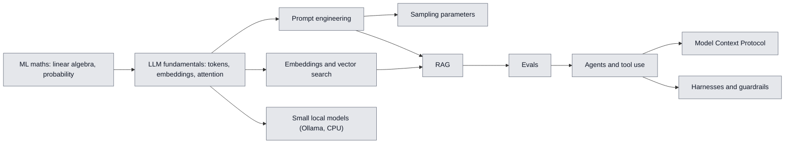

# AI Track

LLMs are becoming part of most software. Understanding how they work, how to prompt them, how to measure them (evals) and how to give them tools safely is what separates using AI from engineering with it.

**Durability:** Medium-high. Tools change monthly, but the fundamentals (embeddings, evaluation, guardrails) and the ML maths underneath are durable.

Label: `track:ai`. Lab folders: `labs/ai/<lab>/`.

## Prerequisites

None: this track can start any time.

## Planned labs

An arrow means "do this lab first". The colours follow the [legend in the root README](../../README.md#legend).

<!-- roadmap-sync:start -->

<!-- roadmap-sync:end -->

| Lab | Folder | Status |
|---|---|---|
| `ml-math`: ML maths: linear algebra, probability | — | todo |
| `llm-fundamentals`: LLM fundamentals: tokens, embeddings, attention | — | todo |
| `prompt-engineering`: Prompt engineering | — | todo |
| `sampling-parameters`: Sampling parameters | — | todo |
| `vector-search`: Embeddings and vector search | — | todo |
| `rag`: RAG | — | todo |
| `evals`: Evals | — | todo |
| `agents-tool-use`: Agents and tool use | — | todo |
| `mcp`: Model Context Protocol | — | todo |
| `harnesses-guardrails`: Harnesses and guardrails | — | todo |
| `local-models`: Small local models (Ollama, CPU) | — | todo |

`plan-lab` creates a lab's folder from [`labs/_template/`](../_template/README.md) when you start it, and fills in the Folder column. Until then the plan above is a proposal you can change. Each lab's own README carries its `**Status:**` line; `roadmap-sync` reads those lines to colour the graph and this table.

## Notes

Prompt engineering is also an [Assessments](../../docs/Assessments.md) subject. The guardrails lab can use ai-common's guard hooks as a case study. Local models are limited by your machine's RAM and GPU (see [Isolation](../../docs/Isolation.md)).

## References

Every online source used for this track or its labs goes here (or in the lab's own README), with a one-line note when it isn't obvious.

- [Model Context Protocol](https://modelcontextprotocol.io/)
- [OWASP Top 10 for LLM applications](https://genai.owasp.org/)
- [Ollama](https://ollama.com/)

See also [Tool Landscape](../../docs/Tool-Landscape.md) and [Isolation](../../docs/Isolation.md).
