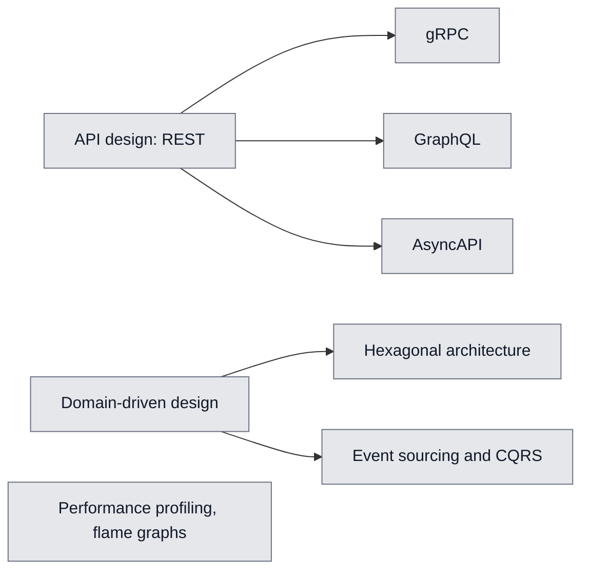

# Architecture and Craft Track

How to shape software so it stays changeable: API contracts, domain boundaries, and the design decisions that keep a codebase easy to change.

**Durability:** High. DDD, hexagonal architecture and contract-first APIs have been mainstream for over a decade.

Label: `track:architecture`. Lab folders: `labs/architecture/<lab>/`.

## Prerequisites

- [JVM Track](../jvm/README.md) or [Python Track](../python/README.md): any one backend track

## Planned labs

An arrow means "do this lab first". The colours follow the [legend in the root README](../../README.md#legend).

<!-- roadmap-sync:start -->

<!-- roadmap-sync:end -->

| Lab | Folder | Status |
|---|---|---|
| `api-design-rest`: API design: REST | — | todo |
| `grpc`: gRPC | — | todo |
| `graphql`: GraphQL | — | todo |
| `asyncapi`: AsyncAPI | — | todo |
| `ddd`: Domain-driven design | — | todo |
| `hexagonal`: Hexagonal architecture | — | todo |
| `event-sourcing-cqrs`: Event sourcing and CQRS | — | todo |
| `profiling`: Performance profiling, flame graphs | — | todo |

`plan-lab` creates a lab's folder from [`labs/_template/`](../_template/README.md) when you start it, and fills in the Folder column. Until then the plan above is a proposal you can change. Each lab's own README carries its `**Status:**` line; `roadmap-sync` reads those lines to colour the graph and this table.

## Notes

Starts after any one backend track. Testing (property-based, Testcontainers, contract tests, TDD, BDD and the rest of the pyramid) moved to the [Testing Track](../testing/README.md).

## References

Every online source used for this track or its labs goes here (or in the lab's own README), with a one-line note when it isn't obvious.

- [gRPC](https://grpc.io/docs/)
- [GraphQL](https://graphql.org/learn/)
- [AsyncAPI](https://www.asyncapi.com/docs)
- [Flame graphs (Brendan Gregg)](https://www.brendangregg.com/flamegraphs.html)

See also [Tool Landscape](../../docs/Tool-Landscape.md) and [Isolation](../../docs/Isolation.md).
