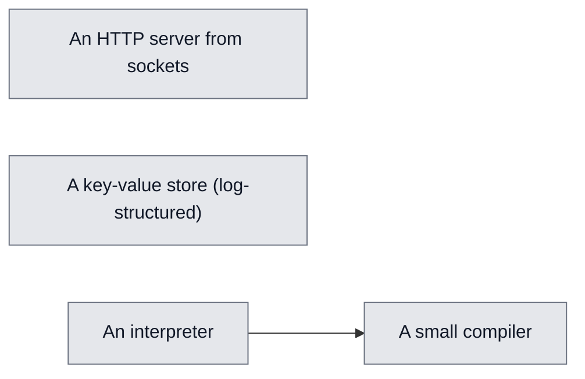

# Classics Track

Building the tools you use every day, in small versions, gives an understanding no tutorial can: after writing an interpreter, every language makes more sense.

**Durability:** Very high. These projects teach parsing, storage and networking, which don't age.

Label: `track:classics`. Lab folders: `labs/classics/<lab>/`.

## Prerequisites

- [Foundations Track](../foundations/README.md)

## Planned labs

An arrow means "do this lab first". The colours follow the [legend in the root README](../../README.md#legend).

<!-- roadmap-sync:start -->

<!-- roadmap-sync:end -->

| Lab | Folder | Status |
|---|---|---|
| `http-server`: An HTTP server from sockets | — | todo |
| `kv-store`: A key-value store (log-structured) | — | todo |
| `interpreter`: An interpreter | — | todo |
| `compiler`: A small compiler | — | todo |

`plan-lab` creates a lab's folder from [`labs/_template/`](../_template/README.md) when you start it, and fills in the Folder column. Until then the plan above is a proposal you can change. Each lab's own README carries its `**Status:**` line; `roadmap-sync` reads those lines to colour the graph and this table.

## Notes

Starts after any one programming language.

## References

Every online source used for this track or its labs goes here (or in the lab's own README), with a one-line note when it isn't obvious.

- [Crafting Interpreters](https://craftinginterpreters.com/)

See also [Tool Landscape](../../docs/Tool-Landscape.md) and [Isolation](../../docs/Isolation.md).
