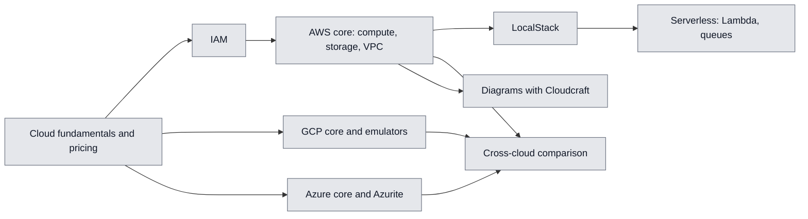

# Cloud Track

The three big clouds share the same building blocks (compute, IAM, storage, queues, serverless). Learning one deeply and the others by comparison is cheaper than learning three separately.

**Durability:** High. IAM and the shared-responsibility model are stable; service names change.

Label: `track:cloud`. Lab folders: `labs/cloud/<lab>/`.

## Prerequisites

- [Foundations Track](../foundations/README.md)

## Planned labs

An arrow means "do this lab first". The colours follow the [legend in the root README](../../README.md#legend).

<!-- roadmap-sync:start -->

<!-- roadmap-sync:end -->

| Lab | Folder | Status |
|---|---|---|
| `cloud-fundamentals`: Cloud fundamentals and pricing | — | todo |
| `iam`: IAM | — | todo |
| `aws-core`: AWS core: compute, storage, VPC | — | todo |
| `localstack`: LocalStack | — | todo |
| `aws-serverless`: Serverless: Lambda, queues | — | todo |
| `gcp-core`: GCP core and emulators | — | todo |
| `azure-core`: Azure core and Azurite | — | todo |
| `cross-cloud`: Cross-cloud comparison | — | todo |
| `cloudcraft`: Diagrams with Cloudcraft | — | todo |

`plan-lab` creates a lab's folder from [`labs/_template/`](../_template/README.md) when you start it, and fills in the Folder column. Until then the plan above is a proposal you can change. Each lab's own README carries its `**Status:**` line; `roadmap-sync` reads those lines to colour the graph and this table.

## Notes

Set a budget alert before creating any real cloud resource ([Isolation](../../docs/Isolation.md)).

## References

Every online source used for this track or its labs goes here (or in the lab's own README), with a one-line note when it isn't obvious.

- [AWS docs](https://docs.aws.amazon.com/)
- [Google Cloud docs](https://cloud.google.com/docs)
- [Azure docs](https://learn.microsoft.com/azure/)
- [LocalStack](https://docs.localstack.cloud/)
- [Cloudcraft](https://www.cloudcraft.co/)

See also [Tool Landscape](../../docs/Tool-Landscape.md) and [Isolation](../../docs/Isolation.md).
