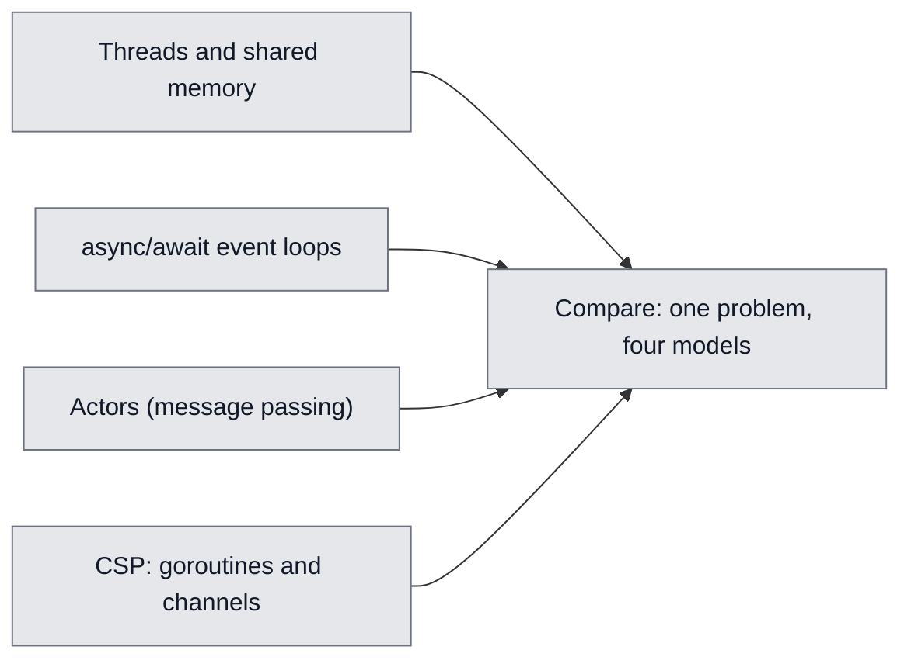

# Concurrency Models Track

One problem solved four ways: threads, async/await, actors and CSP. Seeing the same problem in each model shows what each one makes easy and what it makes hard.

**Durability:** Very high. These four models have existed for decades and keep returning in new languages.

Label: `track:concurrency`. Lab folders: `labs/concurrency/<lab>/`.

## Prerequisites

- [JVM Track](../jvm/README.md)
- [Python Track](../python/README.md)

## Planned labs

An arrow means "do this lab first". The colours follow the [legend in the root README](../../README.md#legend).

<!-- roadmap-sync:start -->

<!-- roadmap-sync:end -->

| Lab | Folder | Status |
|---|---|---|
| `threads-shared-memory`: Threads and shared memory | — | todo |
| `async-await`: async/await event loops | — | todo |
| `actors`: Actors (message passing) | — | todo |
| `csp-go`: CSP: goroutines and channels | — | todo |
| `compare`: Compare: one problem, four models | — | todo |

`plan-lab` creates a lab's folder from [`labs/_template/`](../_template/README.md) when you start it, and fills in the Folder column. Until then the plan above is a proposal you can change. Each lab's own README carries its `**Status:**` line; `roadmap-sync` reads those lines to colour the graph and this table.

## References

Every online source used for this track or its labs goes here (or in the lab's own README), with a one-line note when it isn't obvious.

- [Effective Go: concurrency](https://go.dev/doc/effective_go#concurrency)
- [Apache Pekko (actors)](https://pekko.apache.org/)
- [Python docs: asyncio](https://docs.python.org/3/library/asyncio.html)

See also [Tool Landscape](../../docs/Tool-Landscape.md) and [Isolation](../../docs/Isolation.md).
