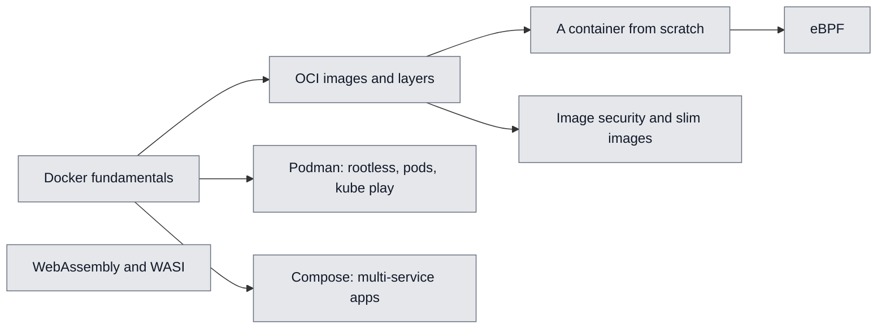

# Containers Track

Containers are the unit of almost every deployment today. Building one from scratch shows they are just Linux processes with namespaces, cgroups and a filesystem image.

**Durability:** High. OCI images and the namespace/cgroup model are standards; engines come and go.

Label: `track:containers`. Lab folders: `labs/containers/<lab>/`.

## Prerequisites

- [Foundations Track](../foundations/README.md)

## Planned labs

An arrow means "do this lab first". The colours follow the [legend in the root README](../../README.md#legend).

<!-- roadmap-sync:start -->

<!-- roadmap-sync:end -->

| Lab | Folder | Status |
|---|---|---|
| `docker-fundamentals`: Docker fundamentals | — | todo |
| `oci-images`: OCI images and layers | — | todo |
| `container-from-scratch`: A container from scratch | — | todo |
| `podman`: Podman: rootless, pods, kube play | — | todo |
| `compose`: Compose: multi-service apps | — | todo |
| `image-security`: Image security and slim images | — | todo |
| `ebpf`: eBPF | — | todo |
| `wasm-wasi`: WebAssembly and WASI | — | todo |

`plan-lab` creates a lab's folder from [`labs/_template/`](../_template/README.md) when you start it, and fills in the Folder column. Until then the plan above is a proposal you can change. Each lab's own README carries its `**Status:**` line; `roadmap-sync` reads those lines to colour the graph and this table.

## References

Every online source used for this track or its labs goes here (or in the lab's own README), with a one-line note when it isn't obvious.

- [Docker docs](https://docs.docker.com/)
- [Podman](https://podman.io/)
- [Open Container Initiative](https://opencontainers.org/)
- [eBPF](https://ebpf.io/)
- [WASI](https://wasi.dev/)

See also [Tool Landscape](../../docs/Tool-Landscape.md) and [Isolation](../../docs/Isolation.md).
