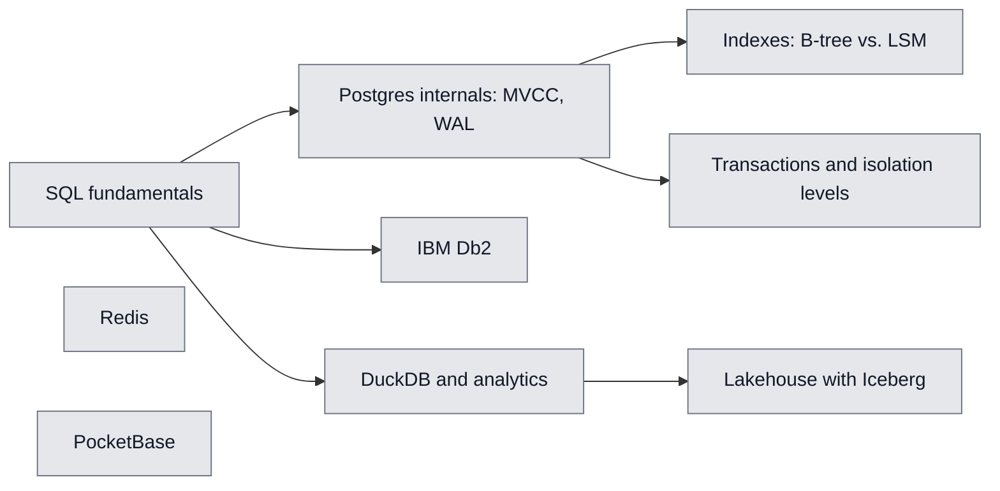

# Data Track

Databases hold the state that everything else is built around. Knowing how storage engines, indexes and isolation levels work explains most performance and correctness problems.

**Durability:** Very high. B-trees, MVCC and SQL have lasted for decades.

Label: `track:data`. Lab folders: `labs/data/<lab>/`.

## Prerequisites

None: this track can start any time.

## Planned labs

An arrow means "do this lab first". The colours follow the [legend in the root README](../../README.md#legend).

<!-- roadmap-sync:start -->

<!-- roadmap-sync:end -->

| Lab | Folder | Status |
|---|---|---|
| `sql`: SQL fundamentals | — | todo |
| `postgres-internals`: Postgres internals: MVCC, WAL | — | todo |
| `indexing`: Indexes: B-tree vs. LSM | — | todo |
| `isolation-levels`: Transactions and isolation levels | — | todo |
| `ibm-db2`: IBM Db2 | — | todo |
| `duckdb`: DuckDB and analytics | — | todo |
| `iceberg`: Lakehouse with Iceberg | — | todo |
| `redis`: Redis | — | todo |
| `pocketbase`: PocketBase | — | todo |

`plan-lab` creates a lab's folder from [`labs/_template/`](../_template/README.md) when you start it, and fills in the Folder column. Until then the plan above is a proposal you can change. Each lab's own README carries its `**Status:**` line; `roadmap-sync` reads those lines to colour the graph and this table.

## References

Every online source used for this track or its labs goes here (or in the lab's own README), with a one-line note when it isn't obvious.

- [PostgreSQL](https://www.postgresql.org/docs/)
- [Redis](https://redis.io/docs/)
- [DuckDB](https://duckdb.org/docs/)
- [Apache Iceberg](https://iceberg.apache.org/docs/latest/)
- [IBM Db2](https://www.ibm.com/docs/en/db2)
- [PocketBase](https://pocketbase.io/docs/)

See also [Tool Landscape](../../docs/Tool-Landscape.md) and [Isolation](../../docs/Isolation.md).
