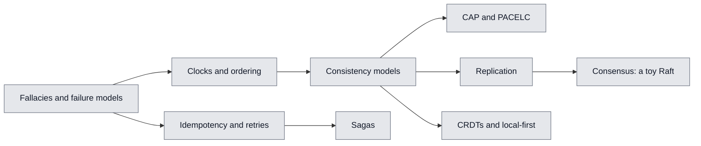

# Distributed Systems Track

The most durable track. Every system with more than one machine meets the same problems: partial failure, unreliable clocks, consistency trade-offs, and agreement.

**Durability:** Very high. Lamport clocks are from 1978 and Raft from 2014; the problems don't change.

Label: `track:distributed`. Lab folders: `labs/distributed/<lab>/`.

## Prerequisites

- [Eventing and Streaming Track](../eventing/README.md)
- [Data Track](../data/README.md)

## Planned labs

An arrow means "do this lab first". The colours follow the [legend in the root README](../../README.md#legend).

<!-- roadmap-sync:start -->

<!-- roadmap-sync:end -->

| Lab | Folder | Status |
|---|---|---|
| `failure-models`: Fallacies and failure models | — | todo |
| `clocks`: Clocks and ordering | — | todo |
| `consistency-models`: Consistency models | — | todo |
| `cap-pacelc`: CAP and PACELC | — | todo |
| `replication`: Replication | — | todo |
| `raft`: Consensus: a toy Raft | — | todo |
| `idempotency-retries`: Idempotency and retries | — | todo |
| `sagas`: Sagas | — | todo |
| `crdts`: CRDTs and local-first | — | todo |

`plan-lab` creates a lab's folder from [`labs/_template/`](../_template/README.md) when you start it, and fills in the Folder column. Until then the plan above is a proposal you can change. Each lab's own README carries its `**Status:**` line; `roadmap-sync` reads those lines to colour the graph and this table.

## References

Every online source used for this track or its labs goes here (or in the lab's own README), with a one-line note when it isn't obvious.

- [Raft](https://raft.github.io/)
- [Jepsen: consistency models](https://jepsen.io/consistency)
- [CRDT resources](https://crdt.tech/)

See also [Tool Landscape](../../docs/Tool-Landscape.md) and [Isolation](../../docs/Isolation.md).
