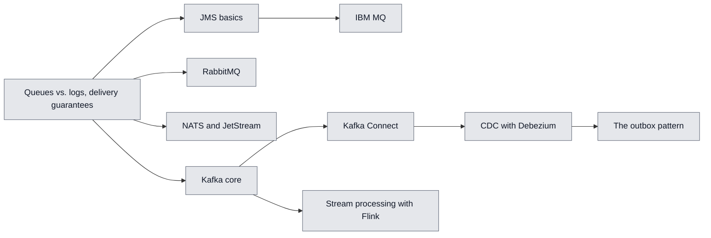

# Eventing and Streaming Track

Queues and logs decouple services in time. Comparing a transactional queue (IBM MQ) with a replayable log (Kafka) shows what each guarantee costs.

**Durability:** High. Messaging patterns (pub/sub, queues, logs, outbox) are decades old; Kafka has been the default log for over ten years.

Label: `track:eventing`. Lab folders: `labs/eventing/<lab>/`.

## Prerequisites

- [Containers Track](../containers/README.md)
- [JVM Track](../jvm/README.md)

## Planned labs

An arrow means "do this lab first". The colours follow the [legend in the root README](../../README.md#legend).

<!-- roadmap-sync:start -->

<!-- roadmap-sync:end -->

| Lab | Folder | Status |
|---|---|---|
| `messaging-concepts`: Queues vs. logs, delivery guarantees | — | todo |
| `jms`: JMS basics | — | todo |
| `ibm-mq`: IBM MQ | — | todo |
| `rabbitmq`: RabbitMQ | — | todo |
| `nats`: NATS and JetStream | — | todo |
| `kafka-core`: Kafka core | — | todo |
| `kafka-connect`: Kafka Connect | — | todo |
| `cdc-debezium`: CDC with Debezium | — | todo |
| `outbox`: The outbox pattern | — | todo |
| `flink`: Stream processing with Flink | — | todo |

`plan-lab` creates a lab's folder from [`labs/_template/`](../_template/README.md) when you start it, and fills in the Folder column. Until then the plan above is a proposal you can change. Each lab's own README carries its `**Status:**` line; `roadmap-sync` reads those lines to colour the graph and this table.

## References

Every online source used for this track or its labs goes here (or in the lab's own README), with a one-line note when it isn't obvious.

- [Apache Kafka](https://kafka.apache.org/documentation/)
- [RabbitMQ](https://www.rabbitmq.com/docs)
- [NATS](https://docs.nats.io/)
- [IBM MQ](https://www.ibm.com/docs/en/ibm-mq)
- [Debezium](https://debezium.io/documentation/)
- [Apache Flink](https://flink.apache.org/)

See also [Tool Landscape](../../docs/Tool-Landscape.md) and [Isolation](../../docs/Isolation.md).
