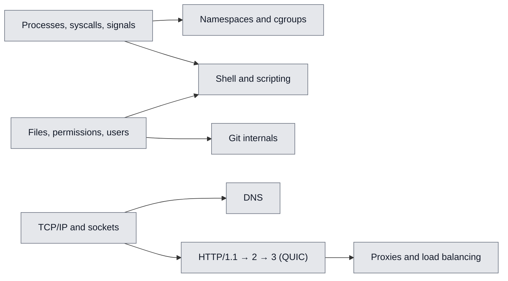

# Foundations Track

Every other track is built on these: a container is Linux namespaces and cgroups, a service mesh is TLS plus proxies, a cloud is networking plus IAM. Learning them once makes every later tool faster to learn.

**Durability:** Very high. Processes, sockets, DNS and HTTP have been stable for decades and will outlast every tool on this list.

Label: `track:foundations`. Lab folders: `labs/foundations/<lab>/`.

## Prerequisites

None: this track can start any time.

## Planned labs

An arrow means "do this lab first". The colours follow the [legend in the root README](../../README.md#legend).

<!-- roadmap-sync:start -->

<!-- roadmap-sync:end -->

| Lab | Folder | Status |
|---|---|---|
| `linux-processes`: Processes, syscalls, signals | — | todo |
| `linux-filesystems`: Files, permissions, users | — | todo |
| `linux-namespaces-cgroups`: Namespaces and cgroups | — | todo |
| `shell`: Shell and scripting | — | todo |
| `networking-tcpip`: TCP/IP and sockets | — | todo |
| `dns`: DNS | — | todo |
| `http`: HTTP/1.1 → 2 → 3 (QUIC) | — | todo |
| `load-balancing`: Proxies and load balancing | — | todo |
| `git-internals`: Git internals | — | todo |

`plan-lab` creates a lab's folder from [`labs/_template/`](../_template/README.md) when you start it, and fills in the Folder column. Until then the plan above is a proposal you can change. Each lab's own README carries its `**Status:**` line; `roadmap-sync` reads those lines to colour the graph and this table.

## References

Every online source used for this track or its labs goes here (or in the lab's own README), with a one-line note when it isn't obvious.

- [Linux man pages](https://man7.org/linux/man-pages/)
- [MDN: HTTP](https://developer.mozilla.org/en-US/docs/Web/HTTP)
- [RFC Editor](https://www.rfc-editor.org/)
- [Pro Git](https://git-scm.com/book)

See also [Tool Landscape](../../docs/Tool-Landscape.md) and [Isolation](../../docs/Isolation.md).
