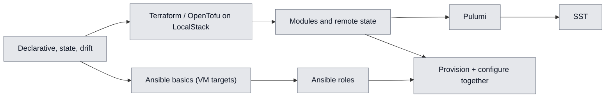

# Infrastructure as Code Track

Infrastructure described in files can be reviewed, repeated and destroyed. Provisioning (Terraform, Pulumi, SST) and configuration (Ansible) are two halves of the same idea.

**Durability:** High. Declarative state with plan/apply has been the standard approach for a decade; tools change, the model stays.

Label: `track:iac`. Lab folders: `labs/iac/<lab>/`.

## Prerequisites

- [Cloud Track](../cloud/README.md)
- [Virtualization Track](../virtualization/README.md)

## Planned labs

An arrow means "do this lab first". The colours follow the [legend in the root README](../../README.md#legend).

<!-- roadmap-sync:start -->

<!-- roadmap-sync:end -->

| Lab | Folder | Status |
|---|---|---|
| `iac-concepts`: Declarative, state, drift | — | todo |
| `terraform-opentofu`: Terraform / OpenTofu on LocalStack | — | todo |
| `modules-state`: Modules and remote state | — | todo |
| `pulumi`: Pulumi | — | todo |
| `sst`: SST | — | todo |
| `ansible`: Ansible basics (VM targets) | — | todo |
| `ansible-roles`: Ansible roles | — | todo |
| `terraform-plus-ansible`: Provision + configure together | — | todo |

`plan-lab` creates a lab's folder from [`labs/_template/`](../_template/README.md) when you start it, and fills in the Folder column. Until then the plan above is a proposal you can change. Each lab's own README carries its `**Status:**` line; `roadmap-sync` reads those lines to colour the graph and this table.

## References

Every online source used for this track or its labs goes here (or in the lab's own README), with a one-line note when it isn't obvious.

- [Terraform](https://developer.hashicorp.com/terraform/docs)
- [OpenTofu](https://opentofu.org/docs/)
- [Pulumi](https://www.pulumi.com/docs/)
- [SST](https://sst.dev/docs/)
- [Ansible](https://docs.ansible.com/)

See also [Tool Landscape](../../docs/Tool-Landscape.md) and [Isolation](../../docs/Isolation.md).
