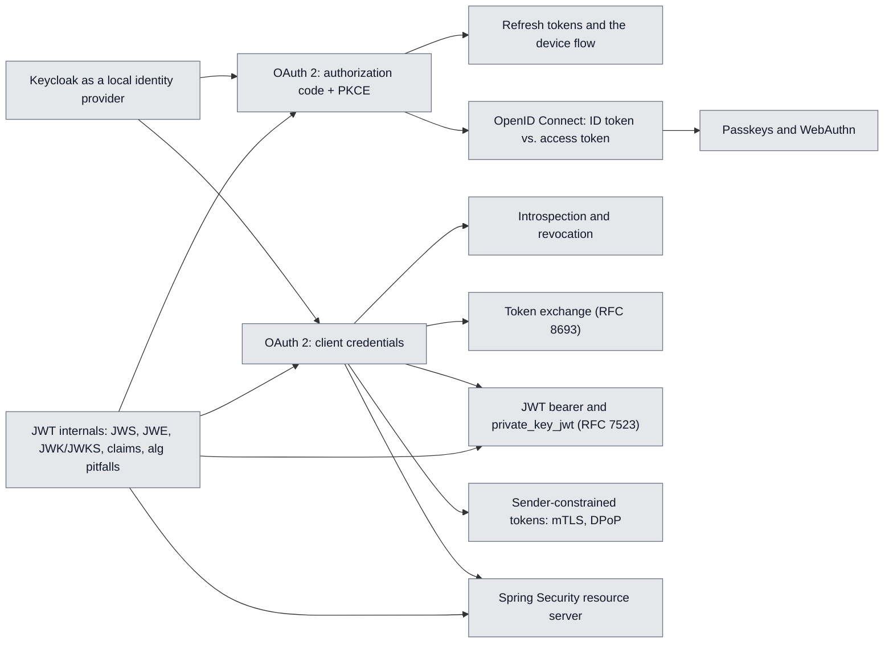

# Identity and Access Track

Who is calling, on whose behalf, and with which rights: tokens, grants and identity providers
sit in front of almost every API. Knowing how a JWT is validated, why PKCE exists and when to
use client credentials or token exchange turns "the login is broken" from a mystery into a
five-minute diagnosis.

**Durability:** Very high. OAuth 2 and JWT have been the basis of API security for over a
decade. OAuth 2.1 and sender-constrained tokens tighten the same ideas rather than replace them.

Label: `track:identity`. Lab folders: `labs/identity/<lab>/`.

## Prerequisites

- [Foundations Track](../foundations/README.md): HTTP, headers, redirects, cookies
- [Security Track](../security/README.md): the TLS/PKI lab (signatures, keys, certificates).
  The mTLS lab is needed before sender-constrained tokens.

## Planned labs

An arrow means "do this lab first". The colours follow the [legend in the root README](../../README.md#legend).

<!-- roadmap-sync:start -->

<!-- roadmap-sync:end -->

| Lab | Folder | Status |
|---|---|---|
| `jwt`: JWT internals: JWS, JWE, JWK/JWKS rotation, claims, validation, `alg` pitfalls | — | todo |
| `keycloak-idp`: Keycloak as a local identity provider (container) | — | todo |
| `oauth2-auth-code-pkce`: authorization code + PKCE | — | todo |
| `oauth2-client-credentials`: client credentials (service to service) | — | todo |
| `refresh-device-flow`: refresh tokens and the device authorization flow | — | todo |
| `oidc`: OpenID Connect, ID token vs. access token, discovery | — | todo |
| `introspection-revocation`: token introspection and revocation | — | todo |
| `token-exchange`: token exchange, delegation vs. impersonation | — | todo |
| `jwt-bearer-client-auth`: JWT bearer grant and `private_key_jwt` client authentication | — | todo |
| `sender-constrained-tokens`: mTLS-bound tokens and DPoP | — | todo |
| `spring-resource-server`: a Spring Security resource server validating tokens | — | todo |
| `passkeys-webauthn`: passkeys and WebAuthn | — | todo |

`plan-lab` creates a lab's folder from [`labs/_template/`](../_template/README.md) when you start it, and fills in the Folder column. Until then the plan above is a proposal you can change. Each lab's own README carries its `**Status:**` line; `roadmap-sync` reads those lines to colour the graph and this table.

## Notes

- Keycloak runs as a container (T1). Check that your Keycloak version
  supports standard token exchange before the token-exchange lab (verify).
- The Spring resource server lab assumes the [JVM Track](../jvm/README.md)'s Spring Boot lab.
- Sender-constrained tokens need the Security Track's mTLS lab.
- See [Tool Landscape](../../docs/Tool-Landscape.md) for Keycloak vs. other identity providers.

## References

Every online source used for this track or its labs goes here (or in the lab's own README), with a one-line note when it isn't obvious.

- [RFC 7519: JSON Web Token (JWT)](https://www.rfc-editor.org/rfc/rfc7519)
- [RFC 7515: JWS](https://www.rfc-editor.org/rfc/rfc7515), [RFC 7516: JWE](https://www.rfc-editor.org/rfc/rfc7516), [RFC 7517: JWK](https://www.rfc-editor.org/rfc/rfc7517)
- [RFC 6749: OAuth 2.0](https://www.rfc-editor.org/rfc/rfc6749) and [RFC 7636: PKCE](https://www.rfc-editor.org/rfc/rfc7636)
- [RFC 8628: Device Authorization Grant](https://www.rfc-editor.org/rfc/rfc8628)
- [RFC 8693: Token Exchange](https://www.rfc-editor.org/rfc/rfc8693)
- [RFC 7523: JWT profile for client authentication and authorization grants](https://www.rfc-editor.org/rfc/rfc7523)
- [RFC 7662: Token Introspection](https://www.rfc-editor.org/rfc/rfc7662) and [RFC 7009: Token Revocation](https://www.rfc-editor.org/rfc/rfc7009)
- [RFC 8705: OAuth 2.0 mutual-TLS](https://www.rfc-editor.org/rfc/rfc8705) and [RFC 9449: DPoP](https://www.rfc-editor.org/rfc/rfc9449)
- [RFC 9700: OAuth 2.0 Security Best Current Practice](https://www.rfc-editor.org/rfc/rfc9700)
- [OpenID Connect Core 1.0](https://openid.net/specs/openid-connect-core-1_0.html)
- [OAuth community site](https://oauth.net/): overview of all grants and the OAuth 2.1 draft
- [Keycloak documentation](https://www.keycloak.org/documentation)
- [Spring Security: OAuth 2.0 resource server](https://docs.spring.io/spring-security/reference/servlet/oauth2/resource-server/index.html)
- [WebAuthn spec (W3C)](https://www.w3.org/TR/webauthn/)

See also [Tool Landscape](../../docs/Tool-Landscape.md) and [Isolation](../../docs/Isolation.md).
