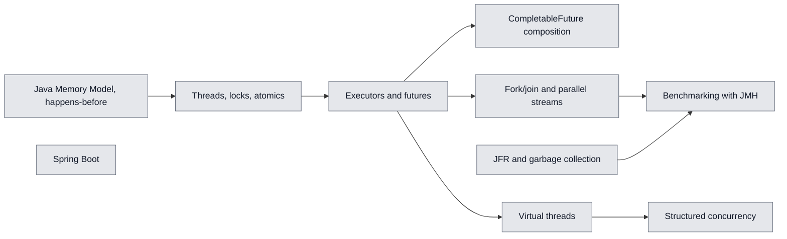

# JVM Track

Java concurrency teaches the memory model, visibility and contention, which explain bugs in any language. JVM tooling (JFR, JMH) teaches how to measure instead of guess.

**Durability:** High. The Java Memory Model has been stable since Java 5; virtual threads and structured concurrency set the direction for the next decade.

Label: `track:jvm`. Lab folders: `labs/jvm/<lab>/`.

## Prerequisites

None: this track can start any time.

## Planned labs

An arrow means "do this lab first". The colours follow the [legend in the root README](../../README.md#legend).

<!-- roadmap-sync:start -->

<!-- roadmap-sync:end -->

| Lab | Folder | Status |
|---|---|---|
| `java-memory-model`: Java Memory Model, happens-before | — | todo |
| `threads-locks`: Threads, locks, atomics | — | todo |
| `executors-futures`: Executors and futures | — | todo |
| `completablefuture`: CompletableFuture composition | — | todo |
| `fork-join-parallel`: Fork/join and parallel streams | — | todo |
| `virtual-threads`: Virtual threads | — | todo |
| `structured-concurrency`: Structured concurrency | — | todo |
| `jfr-gc`: JFR and garbage collection | — | todo |
| `jmh`: Benchmarking with JMH | — | todo |
| `spring-boot`: Spring Boot | — | todo |

`plan-lab` creates a lab's folder from [`labs/_template/`](../_template/README.md) when you start it, and fills in the Folder column. Until then the plan above is a proposal you can change. Each lab's own README carries its `**Status:**` line; `roadmap-sync` reads those lines to colour the graph and this table.

## References

Every online source used for this track or its labs goes here (or in the lab's own README), with a one-line note when it isn't obvious.

- [Java Language Specification, ch. 17 (threads and locks)](https://docs.oracle.com/javase/specs/)
- [JEP index](https://openjdk.org/jeps/0)
- [JMH](https://github.com/openjdk/jmh)
- [Spring Boot](https://spring.io/projects/spring-boot)

See also [Tool Landscape](../../docs/Tool-Landscape.md) and [Isolation](../../docs/Isolation.md).
