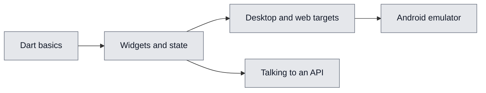

# Mobile Track

Flutter builds for mobile, desktop and web from one codebase, and its declarative UI model (state in, widgets out) is shared with React, SwiftUI and Compose.

**Durability:** Medium-high. Declarative UI is durable; Flutter itself is one framework among several.

Label: `track:mobile`. Lab folders: `labs/mobile/<lab>/`.

## Prerequisites

None: this track can start any time.

## Planned labs

An arrow means "do this lab first". The colours follow the [legend in the root README](../../README.md#legend).

<!-- roadmap-sync:start -->

<!-- roadmap-sync:end -->

| Lab | Folder | Status |
|---|---|---|
| `dart`: Dart basics | — | todo |
| `flutter-widgets-state`: Widgets and state | — | todo |
| `flutter-desktop-web`: Desktop and web targets | — | todo |
| `flutter-networking`: Talking to an API | — | todo |
| `flutter-android`: Android emulator | — | todo |

`plan-lab` creates a lab's folder from [`labs/_template/`](../_template/README.md) when you start it, and fills in the Folder column. Until then the plan above is a proposal you can change. Each lab's own README carries its `**Status:**` line; `roadmap-sync` reads those lines to colour the graph and this table.

## Notes

The Android emulator needs a lot of disk and RAM, and KVM (nested virtualization inside the VM), so check the budget first ([Isolation](../../docs/Isolation.md)).

## References

Every online source used for this track or its labs goes here (or in the lab's own README), with a one-line note when it isn't obvious.

- [Dart](https://dart.dev/)
- [Flutter](https://docs.flutter.dev/)

See also [Tool Landscape](../../docs/Tool-Landscape.md) and [Isolation](../../docs/Isolation.md).
