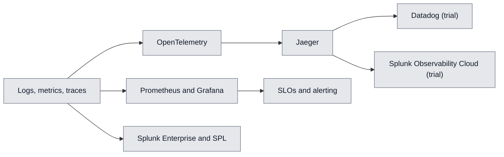

# Observability Track

You can't fix what you can't see. Logs, metrics and traces are how every production system is understood, and OpenTelemetry is the common layer that feeds every backend.

**Durability:** Very high for the concepts and OpenTelemetry; medium for each commercial suite.

Label: `track:observability`. Lab folders: `labs/observability/<lab>/`.

## Prerequisites

- [Containers Track](../containers/README.md)

## Planned labs

An arrow means "do this lab first". The colours follow the [legend in the root README](../../README.md#legend).

<!-- roadmap-sync:start -->

<!-- roadmap-sync:end -->

| Lab | Folder | Status |
|---|---|---|
| `three-pillars`: Logs, metrics, traces | — | todo |
| `prometheus-grafana`: Prometheus and Grafana | — | todo |
| `opentelemetry`: OpenTelemetry | — | todo |
| `jaeger`: Jaeger | — | todo |
| `splunk-enterprise`: Splunk Enterprise and SPL | — | todo |
| `datadog`: Datadog (trial) | — | todo |
| `splunk-observability-cloud`: Splunk Observability Cloud (trial) | — | todo |
| `slo-alerting`: SLOs and alerting | — | todo |

`plan-lab` creates a lab's folder from [`labs/_template/`](../_template/README.md) when you start it, and fills in the Folder column. Until then the plan above is a proposal you can change. Each lab's own README carries its `**Status:**` line; `roadmap-sync` reads those lines to colour the graph and this table.

## Notes

Datadog and Splunk Observability Cloud are time-limited trials: finish the local labs first ([Tool Landscape](../../docs/Tool-Landscape.md)).

## References

Every online source used for this track or its labs goes here (or in the lab's own README), with a one-line note when it isn't obvious.

- [OpenTelemetry](https://opentelemetry.io/docs/)
- [Prometheus](https://prometheus.io/docs/)
- [Grafana](https://grafana.com/docs/)
- [Jaeger](https://www.jaegertracing.io/docs/)
- [Datadog](https://docs.datadoghq.com/)
- [Splunk docs](https://docs.splunk.com/)

See also [Tool Landscape](../../docs/Tool-Landscape.md) and [Isolation](../../docs/Isolation.md).
