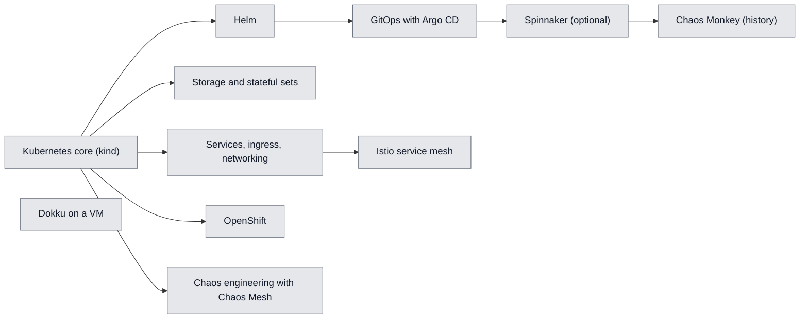

# Orchestration Track

Kubernetes is the shared control plane of modern platforms. OpenShift, Istio, Argo CD and chaos tools all extend it, so learn the core first and each extension becomes a delta.

**Durability:** High. Kubernetes' declarative, reconcile-loop model has been dominant for ten years; Spinnaker and Chaos Monkey are older and declining.

Label: `track:orchestration`. Lab folders: `labs/orchestration/<lab>/`.

## Prerequisites

- [Containers Track](../containers/README.md)
- [Security Track](../security/README.md)
- [Observability Track](../observability/README.md)

## Planned labs

An arrow means "do this lab first". The colours follow the [legend in the root README](../../README.md#legend).

<!-- roadmap-sync:start -->

<!-- roadmap-sync:end -->

| Lab | Folder | Status |
|---|---|---|
| `kubernetes-core`: Kubernetes core (kind) | — | todo |
| `kubernetes-networking`: Services, ingress, networking | — | todo |
| `kubernetes-storage`: Storage and stateful sets | — | todo |
| `helm`: Helm | — | todo |
| `argo-cd`: GitOps with Argo CD | — | todo |
| `openshift`: OpenShift | — | todo |
| `istio`: Istio service mesh | — | todo |
| `chaos-mesh`: Chaos engineering with Chaos Mesh | — | todo |
| `spinnaker`: Spinnaker (optional) | — | todo |
| `chaos-monkey`: Chaos Monkey (history) | — | todo |
| `dokku`: Dokku on a VM | — | todo |

`plan-lab` creates a lab's folder from [`labs/_template/`](../_template/README.md) when you start it, and fills in the Folder column. Until then the plan above is a proposal you can change. Each lab's own README carries its `**Status:**` line; `roadmap-sync` reads those lines to colour the graph and this table.

## Notes

Istio needs the Security Track's mTLS lab; Chaos Mesh needs the Observability Track, so you can see what the failure did. See [Tool Landscape](../../docs/Tool-Landscape.md) for Spinnaker vs. Argo CD.

## References

Every online source used for this track or its labs goes here (or in the lab's own README), with a one-line note when it isn't obvious.

- [Kubernetes](https://kubernetes.io/docs/)
- [kind](https://kind.sigs.k8s.io/)
- [Helm](https://helm.sh/docs/)
- [Argo CD](https://argo-cd.readthedocs.io/)
- [OpenShift (Red Hat docs)](https://docs.redhat.com/)
- [Istio](https://istio.io/latest/docs/)
- [Chaos Mesh](https://chaos-mesh.org/)
- [Spinnaker](https://spinnaker.io/)
- [Chaos Monkey](https://netflix.github.io/chaosmonkey/)
- [Dokku](https://dokku.com/docs/)

See also [Tool Landscape](../../docs/Tool-Landscape.md) and [Isolation](../../docs/Isolation.md).
