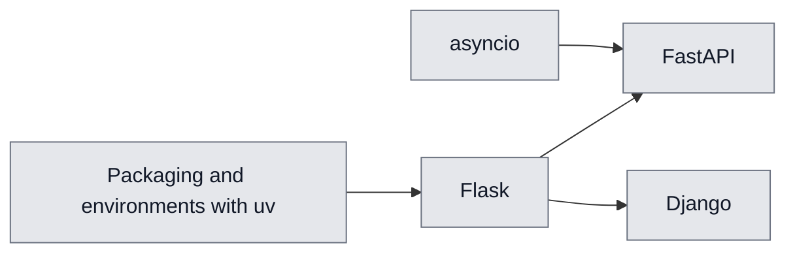

# Python Track

Three web frameworks with three philosophies: Flask (minimal), FastAPI (async and typed), Django (batteries included). Comparing them teaches what a framework does for you.

**Durability:** High for the concepts (WSGI/ASGI, ORMs, async I/O); medium for each framework.

Label: `track:python`. Lab folders: `labs/python/<lab>/`.

## Prerequisites

- [Foundations Track](../foundations/README.md)

## Planned labs

An arrow means "do this lab first". The colours follow the [legend in the root README](../../README.md#legend).

<!-- roadmap-sync:start -->

<!-- roadmap-sync:end -->

| Lab | Folder | Status |
|---|---|---|
| `packaging-uv`: Packaging and environments with uv | — | todo |
| `asyncio`: asyncio | — | todo |
| `flask`: Flask | — | todo |
| `fastapi`: FastAPI | — | todo |
| `django`: Django | — | todo |

`plan-lab` creates a lab's folder from [`labs/_template/`](../_template/README.md) when you start it, and fills in the Folder column. Until then the plan above is a proposal you can change. Each lab's own README carries its `**Status:**` line; `roadmap-sync` reads those lines to colour the graph and this table.

## References

Every online source used for this track or its labs goes here (or in the lab's own README), with a one-line note when it isn't obvious.

- [Python docs: asyncio](https://docs.python.org/3/library/asyncio.html)
- [uv](https://docs.astral.sh/uv/)
- [Flask](https://flask.palletsprojects.com/)
- [FastAPI](https://fastapi.tiangolo.com/)
- [Django](https://docs.djangoproject.com/)

See also [Tool Landscape](../../docs/Tool-Landscape.md) and [Isolation](../../docs/Isolation.md).
