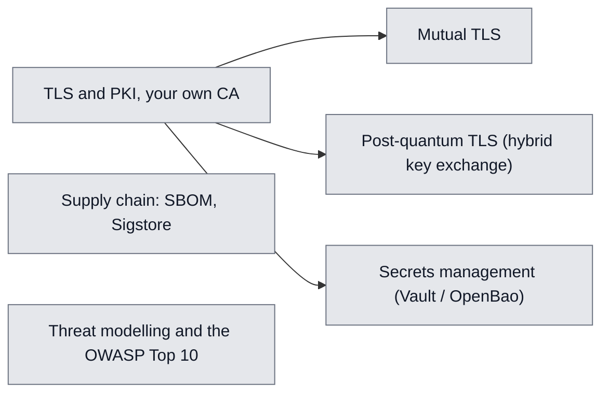

# Security Track

Security knowledge transfers across every stack: the same trust, identity and least-privilege ideas show up in TLS, OAuth, Kubernetes and AI agents.

**Durability:** Very high. PKI has been the basis of web trust for over a decade; post-quantum cryptography is a migration that will run for years.

Label: `track:security`. Lab folders: `labs/security/<lab>/`.

## Prerequisites

- [Foundations Track](../foundations/README.md)

## Planned labs

An arrow means "do this lab first". The colours follow the [legend in the root README](../../README.md#legend).

<!-- roadmap-sync:start -->

<!-- roadmap-sync:end -->

| Lab | Folder | Status |
|---|---|---|
| `tls-pki`: TLS and PKI, your own CA | — | todo |
| `mtls`: Mutual TLS | — | todo |
| `post-quantum-tls`: Post-quantum TLS (hybrid key exchange) | — | todo |
| `secrets-management`: Secrets management (Vault / OpenBao) | — | todo |
| `supply-chain`: Supply chain: SBOM, Sigstore | — | todo |
| `threat-modeling-owasp`: Threat modelling and the OWASP Top 10 | — | todo |

Tokens and logins (JWT, OAuth 2, OIDC, token exchange, passkeys) have their own track: the
[Identity and Access Track](../identity/README.md), which starts after the TLS lab here.

`plan-lab` creates a lab's folder from [`labs/_template/`](../_template/README.md) when you start it, and fills in the Folder column. Until then the plan above is a proposal you can change. Each lab's own README carries its `**Status:**` line; `roadmap-sync` reads those lines to colour the graph and this table.

## References

Every online source used for this track or its labs goes here (or in the lab's own README), with a one-line note when it isn't obvious.

- [OWASP](https://owasp.org/)
- [OpenSSL docs](https://docs.openssl.org/)
- [Sigstore](https://www.sigstore.dev/)
- [OpenBao](https://openbao.org/)
- [NIST post-quantum cryptography](https://csrc.nist.gov/projects/post-quantum-cryptography)

See also [Tool Landscape](../../docs/Tool-Landscape.md) and [Isolation](../../docs/Isolation.md).
