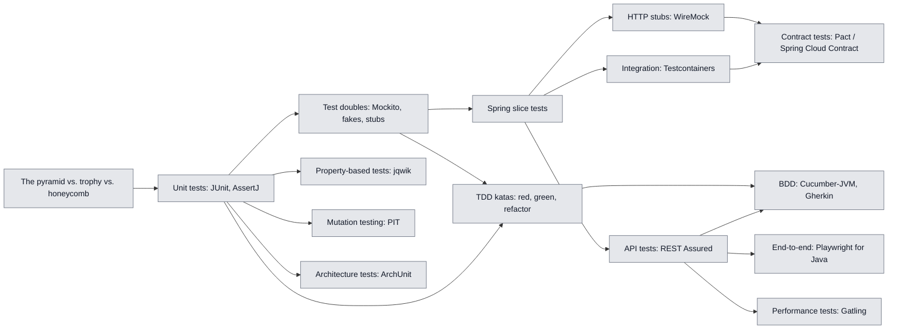

# Testing Track

The test pyramid in a Java project, one level at a time: fast unit tests at the bottom, fewer
and slower integration, contract, API and end-to-end tests above, and the practices that drive
them (TDD, BDD). The goal is to know which test belongs at which level, and why, so the suite
gives confidence without slowing every change down.

**Durability:** Very high. TDD, test doubles and the pyramid are decades old. The tools change
(JUnit 4 → 5, embedded fakes → Testcontainers), but the trade-offs between levels stay the same.

Label: `track:testing`. Lab folders: `labs/testing/<lab>/`.

## Prerequisites

- [JVM Track](../jvm/README.md): Java basics. The Spring slice-test lab and everything above it
  assume the JVM Track's Spring Boot lab.
- [Containers Track](../containers/README.md): only for the Testcontainers lab and the ones that build on it.

## Planned labs

An arrow means "do this lab first". The colours follow the [legend in the root README](../../README.md#legend).

<!-- roadmap-sync:start -->

<!-- roadmap-sync:end -->

| Lab | Folder | Status |
|---|---|---|
| `pyramid-shapes`: the test pyramid compared with the trophy and honeycomb shapes | — | todo |
| `unit-junit-assertj`: unit tests with JUnit and AssertJ | — | todo |
| `test-doubles-mockito`: test-double taxonomy (dummy, stub, spy, mock, fake) with Mockito | — | todo |
| `tdd-katas`: TDD with katas, red-green-refactor | — | todo |
| `property-based-jqwik`: property-based tests with jqwik | — | todo |
| `mutation-pit`: mutation testing with PIT | — | todo |
| `spring-slice-tests`: Spring Boot slice tests (web, data) | — | todo |
| `integration-testcontainers`: integration tests with Testcontainers | — | todo |
| `http-stubs-wiremock`: stubbing HTTP dependencies with WireMock | — | todo |
| `contract-tests`: consumer-driven contracts (Pact or Spring Cloud Contract) | — | todo |
| `api-tests-rest-assured`: API tests with REST Assured | — | todo |
| `bdd-cucumber`: BDD with Cucumber-JVM and Gherkin | — | todo |
| `e2e-playwright`: end-to-end UI tests with Playwright for Java | — | todo |
| `architecture-archunit`: architecture rules as tests with ArchUnit | — | todo |
| `performance-gatling`: load and performance tests with Gatling | — | todo |

`plan-lab` creates a lab's folder from [`labs/_template/`](../_template/README.md) when you start it, and fills in the Folder column. Until then the plan above is a proposal you can change. Each lab's own README carries its `**Status:**` line; `roadmap-sync` reads those lines to colour the graph and this table.

## Notes

- Micro-benchmarks (JMH) stay in the [JVM Track](../jvm/README.md); this track covers load and
  performance tests of a running service.
- Testcontainers on Windows/Podman needs `DOCKER_HOST` pointing at the Podman socket and may need
  Ryuk disabled (verify; see [Platforms](../../docs/Platforms.md)).
- One small Spring Boot service can carry most labs, so each level tests the same code from a
  different height. That is your design choice when you plan the first lab.
- See [Tool Landscape](../../docs/Tool-Landscape.md) for Pact vs. Spring Cloud Contract,
  Cucumber vs. alternatives, and Testcontainers vs. embedded fakes.

## References

Every online source used for this track or its labs goes here (or in the lab's own README), with a one-line note when it isn't obvious.

- [The Practical Test Pyramid (Martin Fowler's site)](https://martinfowler.com/articles/practical-test-pyramid.html)
- [The Testing Trophy (Kent C. Dodds)](https://kentcdodds.com/blog/the-testing-trophy-and-testing-classifications)
- [Testing of microservices: the honeycomb (Spotify Engineering)](https://engineering.atspotify.com/2018/01/testing-of-microservices) (verify)
- [Test doubles (Martin Fowler's bliki)](https://martinfowler.com/bliki/TestDouble.html)
- [JUnit](https://junit.org/) (check the current major version)
- [AssertJ](https://assertj.github.io/doc/)
- [Mockito](https://site.mockito.org/)
- [jqwik](https://jqwik.net/)
- [PIT mutation testing](https://pitest.org/)
- [Spring Boot: testing](https://docs.spring.io/spring-boot/reference/testing/index.html)
- [Testcontainers](https://testcontainers.com/)
- [WireMock](https://wiremock.org/)
- [Pact](https://docs.pact.io/) and [Spring Cloud Contract](https://spring.io/projects/spring-cloud-contract)
- [REST Assured](https://rest-assured.io/)
- [Cucumber](https://cucumber.io/docs/) and the [Gherkin reference](https://cucumber.io/docs/gherkin/reference/)
- [Playwright for Java](https://playwright.dev/java/)
- [ArchUnit](https://www.archunit.org/)
- [Gatling](https://docs.gatling.io/)

See also [Tool Landscape](../../docs/Tool-Landscape.md) and [Isolation](../../docs/Isolation.md).
