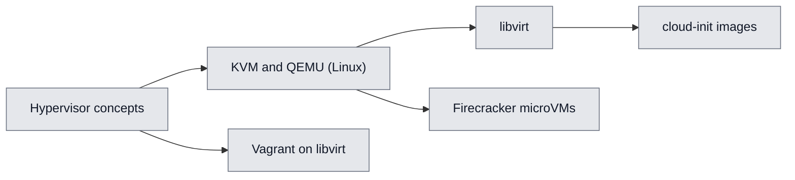

# Virtualization Track

VMs sit under every cloud, and under the Omarchy VM this repo runs in. Knowing what a hypervisor does explains cloud instance types, nested virtualization and microVMs.

**Durability:** High. Hardware virtualization has been the base of the cloud for twenty years; microVMs are its current direction.

Label: `track:virtualization`. Lab folders: `labs/virtualization/<lab>/`.

## Prerequisites

- [Foundations Track](../foundations/README.md)

## Planned labs

An arrow means "do this lab first". The colours follow the [legend in the root README](../../README.md#legend).

<!-- roadmap-sync:start -->

<!-- roadmap-sync:end -->

| Lab | Folder | Status |
|---|---|---|
| `hypervisors`: Hypervisor concepts | — | todo |
| `kvm-qemu`: KVM and QEMU (Linux) | — | todo |
| `libvirt`: libvirt | — | todo |
| `cloud-init`: cloud-init images | — | todo |
| `firecracker`: Firecracker microVMs | — | todo |
| `vagrant-libvirt`: Vagrant on libvirt | — | todo |

`plan-lab` creates a lab's folder from [`labs/_template/`](../_template/README.md) when you start it, and fills in the Folder column. Until then the plan above is a proposal you can change. Each lab's own README carries its `**Status:**` line; `roadmap-sync` reads those lines to colour the graph and this table.

## References

Every online source used for this track or its labs goes here (or in the lab's own README), with a one-line note when it isn't obvious.

- [QEMU docs](https://www.qemu.org/docs/master/)
- [libvirt](https://libvirt.org/)
- [cloud-init](https://cloud-init.io/)
- [Firecracker](https://firecracker-microvm.github.io/)
- [Vagrant](https://developer.hashicorp.com/vagrant)

See also [Tool Landscape](../../docs/Tool-Landscape.md) and [Isolation](../../docs/Isolation.md).
